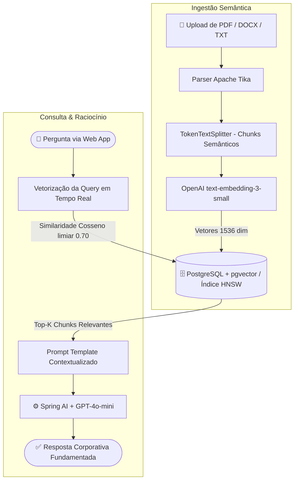

# 🧠 Corporate RAG Engine — Enterprise Semantic Retrieval System

<p align="left">
  <a href="https://github.com/AdrianLopez001/Corporate-RAG-Engine/actions">
    
  </a>
  
  
  
  
  
  
  
</p>

> **Backend RAG (Retrieval-Augmented Generation) de nível empresarial integrando Spring AI, busca vetorial semântica com PostgreSQL + pgvector e indexação HNSW para recuperação de contexto em documentos corporativos.**

---

## 💡 Visão Geral (Problema & Solução)

**O Problema:** Empresas acumulam manuais, regulamentos e procedimentos operacionais (SOPs) em arquivos PDF e DOCX desestruturados. Motores de busca lexicais tradicionais falham em compreender o significado semântico das perguntas, gerando respostas incompletas ou alucinações quando conectados a LLMs.

**A Solução:** O **Corporate RAG Engine** implementa uma esteira corporativa completa de RAG: parsing de documentos com Apache Tika, chunking semântico (`TokenTextSplitter`), geração de embeddings vetoriais, indexação HNSW em PostgreSQL com `pgvector` e orquestração determinística via Spring AI e GPT-4o-mini, acompanhado por interface moderna em React 19 + Vite.

---

## 🏛️ Arquitetura & Fluxo de Dados



---

## ✨ Destaques de Engenharia

- ⚡ **Indexação HNSW (Hierarchical Navigable Small World):** Busca por similaridade vetorial de altíssima performance no PostgreSQL com latência sub-milissegundo.
- 🛡️ **Grounding e Prevenção de Alucinação:** Injeção estrita de contexto recuperado com limiar de similaridade de cosseno (threshold 0.70).
- 🧩 **Arquitetura Desacoplada:** Backend em microsserviço Spring Boot com endpoints REST e frontend reativo em React 19 + Vite + Tailwind CSS.
- 🔄 **Integração Nativa com Spring AI 1.0:** Gerenciamento padronizado de clientes de IA generativa e Vector Stores do ecossistema Spring.
- 🧪 **Pipeline de CI Automatizado:** Testes unitários e de integração configurados com GitHub Actions e Mockito.

---

## 🛠️ Stack Tecnológica

| Camada | Tecnologias |
|---|---|
| **Backend & Core AI** | Java 21, Spring Boot 3.3, Spring AI 1.0.0, Apache Tika, Lombok |
| **Banco Vetorial** | PostgreSQL 16 com extensão `pgvector` (Índice HNSW) |
| **Modelos de IA** | OpenAI `text-embedding-3-small` & `GPT-4o-mini` |
| **Frontend** | React 19, TypeScript, Vite, Tailwind CSS v4, Lucide React, Oxlint |
| **DevOps & CI** | Docker, Docker Compose, GitHub Actions |

---

## 🚀 Como Executar o Projeto

### Pré-requisitos
- Docker & Docker Compose
- Java 21 & Maven (caso deseje rodar localmente sem Docker)
- Node.js 20+
- Chave de API da OpenAI (`OPENAI_API_KEY`)

### 1. Iniciar Banco Vetorial & Backend via Docker

```bash
# 1. Copie o arquivo de exemplo de ambiente
cp .env.example .env

# 2. Insira sua OPENAI_API_KEY no arquivo .env
# 3. Suba os containers
docker compose up -d
```

- **Backend API:** `http://localhost:8080`
- **Documentação Swagger UI:** `http://localhost:8080/swagger-ui.html`

### 2. Iniciar o Frontend Reativo

```bash
# Na raiz do repositório
npm install
npm run dev
```

- **Frontend Web:** `http://localhost:5173`

---

## 🧪 Testes Automatizados

O backend conta com suíte de testes unitários cobrindo o pipeline de ingestão e o fluxo RAG:

```bash
cd backend
./mvnw test
```

---

## 📄 Licença & Contato

Desenvolvido por **Adrian Lopes**  
- LinkedIn: [adrian-lopes](https://linkedin.com/in/adrian-lopes-a42699371)  
- E-mail: [adrianlopes.dev@gmail.com](mailto:adrianlopes.dev@gmail.com)  
- GitHub: [AdrianLopez001](https://github.com/AdrianLopez001)
